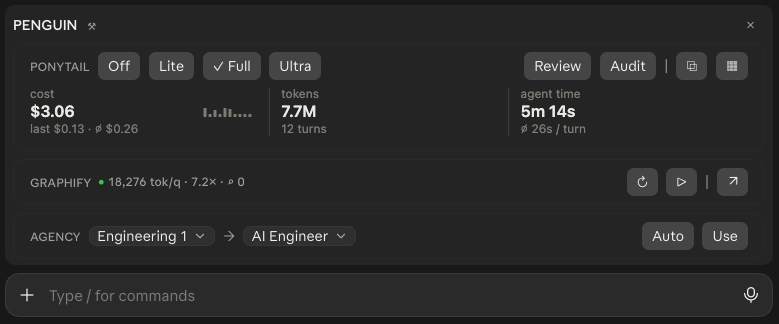
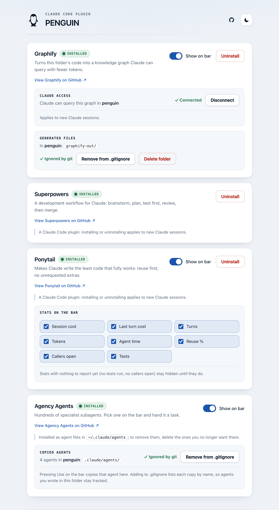
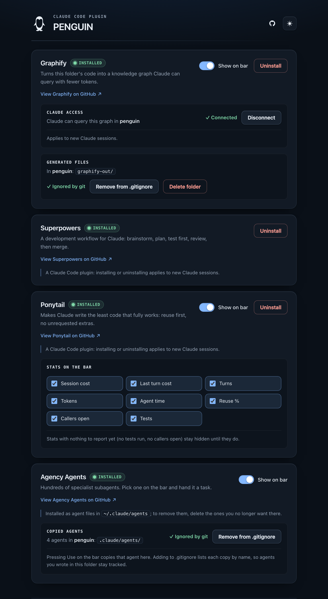

<div align="center">


# PENGUIN

**Prompt Extension Nexus for Generative Utility and Inline Notation**

A toolbar for Claude Code that sits right above the prompt box and puts your favourite Claude add-ons one click away.

[](https://github.com/shaiksajid-in/penguin/stargazers)
[](.claude-plugin/plugin.json)
[](#roadmap)
[](LICENSE)
[](https://github.com/shaiksajid-in/penguin/commits/main)
[](https://github.com/shaiksajid-in/penguin/issues)
[](https://docs.claude.com/en/docs/claude-code/plugins)



</div>

---

## Contents

- [Why PENGUIN](#why-penguin)
- [Features](#features)
- [Screenshots](#screenshots)
- [Requirements](#requirements)
- [Installation](#installation)
- [Usage](#usage)
- [Uninstalling](#uninstalling)
- [How it works](#how-it-works)
- [Privacy and security](#privacy-and-security)
- [Development](#development)
- [Roadmap](#roadmap)
- [Contributing](#contributing)
- [Credits](#credits)
- [License](#license)

## Why PENGUIN

Claude Code has a growing ecosystem of plugins, skills and subagents, but each one lives behind its own slash command or config file. PENGUIN gathers the ones you use every day into one bar above the prompt box. You can see what they're doing and drive them without typing commands.

## Features

| Section | What it gives you |
| --- | --- |
| **Ponytail** | Switch [Ponytail](https://github.com/DietrichGebert/ponytail) between Off, Lite, Full and Ultra with one click. Run Review or Audit, see live session cost, tokens, turns and agent time, copy the stats as Markdown, or open the board of every session. |
| **Graphify** | Build a [Graphify](https://github.com/Graphify-Labs/graphify) knowledge graph of the current folder (↻), rebuild it automatically as files change (▷), and open it in the browser (↗). The bar shows tokens saved per query, how many times fewer tokens that is, and how often Claude queried the graph. |
| **Agency** | Pick any of hundreds of [Agency Agents](https://github.com/msitarzewski/agency-agents) subagents by division. **Use** puts "Use the *agent* agent to …" in the prompt box, and **Auto** lets Claude pick the best one for the task. |
| **Settings page** (⚒) | Install, update and uninstall each tool, choose what shows on the bar, connect Claude to the graph, and keep generated files out of git, all from one local page with light and dark themes. |

The bar also has a compact one-row view (×), and it draws its own logo on desktop and a 🐧 in the terminal.

## Screenshots

<table>
  <tr>
    <td align="center"><b>Settings, light</b></td>
    <td align="center"><b>Settings, dark</b></td>
  </tr>
  <tr>
    <td></td>
    <td></td>
  </tr>
</table>

## Requirements

- [Claude Code](https://docs.claude.com/en/docs/claude-code) with plugin support (the desktop app shows the full bar; the terminal shows a text version)
- `python3` 3.9 or newer, for the local settings page (macOS ships one)
- `git`, for the .gitignore options and the Agency Agents installer
- [`uv`](https://docs.astral.sh/uv/) or [`pipx`](https://pipx.pypa.io/), only if you install Graphify

## Installation

In Claude Code, add this repository as a plugin marketplace and install the plugin:

```text
/plugin marketplace add shaiksajid-in/penguin
/plugin install penguin@penguin
```

Start a new session and the bar appears above the prompt box. Until any tool is installed, it shows a single **⤓** button that opens the settings page.

### Let your agent install it

Copy this prompt and paste it into Claude Code (or any coding agent that can run shell commands):

```text
Install the PENGUIN plugin for Claude Code from https://github.com/shaiksajid-in/penguin.
Run these two commands in the terminal, one after the other:

  claude plugin marketplace add shaiksajid-in/penguin
  claude plugin install penguin@penguin --scope user

If the first command says the marketplace already exists, carry on with the second.
Then confirm it worked with `claude plugin list`, and tell me to start a new
Claude Code session so the PENGUIN bar appears above the prompt box.
```

## Usage

1. **Open settings** with ⚒ (or ⤓ on a fresh install) and press **Install** on the tools you want.
2. **Graphify:** press ↻ to build the graph for the current folder, then **Connect** on the settings page so new Claude sessions can query it. Press ▷ to rebuild automatically as you edit.
3. **Ponytail:** pick a level. Its figures update after every turn, and you choose which ones show under **Stats on the bar**.
4. **Agency:** choose a division and an agent, type your task, and press **Use**, or press **Auto** and let Claude choose.
5. Press **×** to collapse the bar to one row, and **⋯** to bring it back.

Hover any icon on the bar for a tooltip explaining what it does.

## Uninstalling

**1. Remove the tools first (optional).** The tools PENGUIN installed stay installed after PENGUIN is gone, and the settings page goes away with the plugin. So if you want them gone too, open ⚒ settings and, for each project you used:

- press **Disconnect** under *Claude access* so Claude stops loading the Graphify server there
- press **Remove from .gitignore** and **Delete folder** if you no longer want the rules or `graphify-out/`
- press **Uninstall** on Graphify, Superpowers and Ponytail

**2. Uninstall PENGUIN** in Claude Code:

```text
/plugin uninstall penguin@penguin
/plugin marketplace remove penguin
```

Start a new session and the bar is gone.

**3. Clean up leftovers (optional).** Delete PENGUIN's settings file:

```bash
rm -rf ~/.config/penguin
```

Two things are never deleted automatically, because they may hold your own files:

- **Agency Agents** live in `~/.claude/agents/`. Delete the agent files you no longer want there.
- **Agent copies** made by **Use** live in each project's `.claude/agents/`. Delete them there, along with the `# Agency Agents copies (added by PENGUIN)` block in that project's `.gitignore`.

## How it works

```text
.claude-plugin/       plugin and marketplace manifests
hooks/register.tsx    the bar: renders above the prompt, runs Graphify, reads Ponytail's state, lists agents
hooks/ponytail.ts     Ponytail's metrics, drawn as SVG on desktop and text in the terminal
server/               the settings page: a small Python HTTP server plus one HTML file
assets/logo.svg       the logo, used by the bar and the settings page
tests/                bar tests and settings-server tests
```

Settings live in `~/.config/penguin/settings.json`. Graphify writes its graph to `graphify-out/` in your project, and agents you **Use** are copied into the project's `.claude/agents/`. The settings page can add either to `.gitignore` for you.

## Privacy and security

- The settings server listens on `127.0.0.1` only, on a random port, for as long as the session runs.
- Every API call needs a random per-launch token. The token is passed in the URL fragment, so it never reaches server logs or a `Referer` header.
- Requests with any `Host` other than `127.0.0.1` or `localhost` are refused, which blocks DNS rebinding.
- The only commands the server runs are fixed in [`server/settings_server.py`](server/settings_server.py). Nothing from a request is put into a shell command.
- PENGUIN collects no telemetry. Network access happens only when you install or update a tool, and when the settings page checks the tools' marketplaces for updates.

Found a security problem? Please open a [private security advisory](https://github.com/shaiksajid-in/penguin/security/advisories/new) rather than a public issue.

## Development

Clone the repo and point Claude Code at your local copy:

```bash
git clone https://github.com/shaiksajid-in/penguin.git
```

```text
/plugin marketplace add ./penguin
/plugin install penguin@penguin
```

After editing, run `/reload-plugins` in Claude Code to pick up the changes.

Run the settings-server tests:

```bash
python3 -I tests/test_updates.py
```

The bar tests in `tests/band.test.tsx` use Claude Code's plugin test runner (`claude-code/testing`).

## Roadmap

PENGUIN is in **beta**: it works day to day, but the bar's layout and the settings file format may still change.

- [ ] More tools on the bar
- [ ] Per-project bar layouts
- [ ] Linux and Windows testing

Have an idea? [Open an issue](https://github.com/shaiksajid-in/penguin/issues/new).

## Contributing

Contributions are welcome.

1. Fork the repo and create a branch: `git checkout -b feature/my-change`
2. Make your change and run the tests
3. Commit with a clear message and open a pull request

Please keep changes small and focused, and describe what you tested.

## Credits

PENGUIN brings together these projects. All credit for the tools themselves goes to their authors:

- [Graphify](https://github.com/Graphify-Labs/graphify) by Graphify-Labs
- [Ponytail](https://github.com/DietrichGebert/ponytail) by DietrichGebert
- [Superpowers](https://github.com/obra/superpowers) by obra
- [Agency Agents](https://github.com/msitarzewski/agency-agents) by msitarzewski

## License

[MIT](LICENSE) © 2026 Sajid Shaik

<div align="center">
<sub>Built by AI, of AI, for AI, guided by a <a href="https://shaiksajid.in">human</a>.</sub>
<br><br>
If PENGUIN saves you time, consider giving it a ⭐
</div>
